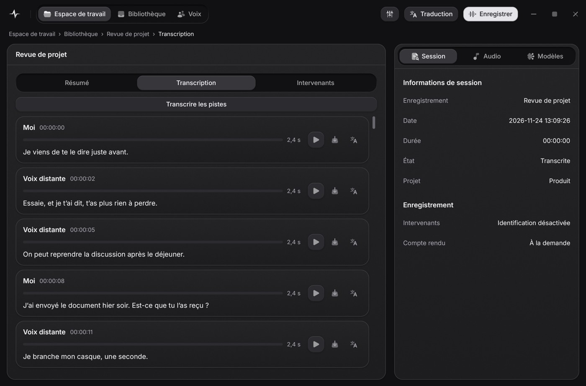

<div align="center">
  
  <h1>Rikai</h1>
  <p>Enregistrez le son de vos applications et de votre micro sur Windows, retrouvez un passage et remontez du compte rendu aux mots prononcés.</p>
  <p>
    <a href="https://github.com/itsKushh/rikai/releases/latest"></a>
    <a href="https://github.com/itsKushh/rikai/actions/workflows/windows.yml"></a>
    
    
    <a href="./LICENSE"></a>
  </p>
  <p><strong><a href="https://github.com/itsKushh/rikai/releases/latest/download/Rikai-Setup-x64.exe">Télécharger pour Windows x64</a></strong> · <a href="https://github.com/itsKushh/rikai/releases">Notes de version</a></p>
</div>

Rikai est une application de bureau native qui enregistre le son des applications que vous choisissez et conserve votre microphone sur une piste séparée. Après l’enregistrement, vous pouvez rechercher une phrase, réécouter l’extrait correspondant et vérifier une décision citée dans le compte rendu. Une fois les modèles téléchargés, la transcription, la traduction et le résumé fonctionnent sur votre ordinateur, hors ligne.

<p align="center">
  
</p>

## Réaliser sa première capture

1. **Installez Rikai.** Exécutez `Rikai-Setup-x64.exe` sous Windows x64 (build 20348 ou ultérieure, dont Windows 11). Choisissez le dossier de destination. L’installeur affiche la progression pour l’application, le moteur audio et les raccourcis de votre compte Windows. Lors d’une mise à niveau, fermez l’ancienne application pour que Rikai puisse reprendre sa bibliothèque.
2. **Choisissez un modèle de transcription.** Dans **Paramètres → Modèles**, sélectionnez **Équilibré** pour commencer, puis **Télécharger**. La barre de progression indique le volume reçu. Vous pouvez aussi sélectionner un modèle Faster-Whisper déjà présent sur votre disque.
3. **Réglez les sources.** Cliquez sur **Enregistrer**, saisissez un titre, choisissez les applications et, si nécessaire, un microphone. Si une application manque, faites-lui jouer un son. Avec **Tester les niveaux**, parlez et ajustez chaque source pour viser des crêtes entre −18 et −6 dBFS.
4. **Enregistrez, puis relisez.** Informez les participants et cliquez sur **Démarrer l’enregistrement**. À l’arrêt, Rikai finalise les pistes et lance la transcription si un modèle est configuré. Dans **Transcription**, cliquez sur la lecture pour écouter un passage ou sur ses mots pour corriger le texte.

La capture suit chaque application sélectionnée et ses processus enfants. Les participants d’un même appel Discord partagent donc une piste. Plusieurs onglets d’un navigateur peuvent aussi se retrouver sur la même piste.

## Explorer un enregistrement

| Besoin | Dans Rikai |
| --- | --- |
| Retrouver une intervention | La bibliothèque recherche les titres, les paroles et les intervenants. Un résultat dans la transcription ouvre le passage correspondant. Des filtres permettent de préciser le projet, le tag ou la date. |
| Vérifier qui parle | Le micro a sa propre piste. Avec les modèles de segmentation et d’empreintes vocales configurés, Rikai peut distinguer les voix distantes. Vous confirmez les noms proposés et recueillez l’accord de la personne avant de créer un profil vocal. |
| Comprendre un passage dans une autre langue | Le bouton de traduction permet de rechercher une langue parmi 100. Le texte traduit est conservé à côté de l’original. Une correction de l’original invalide ses anciennes traductions. |
| Comprendre un enregistrement | Le résumé commence par un aperçu, puis regroupe les sujets avec des références aux paroles. Selon l’échange, il peut aussi relever une difficulté, une piste de travail ou un engagement. Les versions précédentes restent consultables. |
| Partager un résultat | Exportez le compte rendu seul ou avec la transcription en Markdown, texte ou JSON. Le bouton d’export d’un passage enregistre l’extrait audio en WAV. |

## Traduire en direct

Cliquez sur **Traduction** dans la barre supérieure. Dans la seconde fenêtre, sélectionnez les sources à écouter et la langue cible, puis cliquez sur **Enregistrer**. Whisper affiche les paroles reconnues en gris. M2M100 traduit chaque groupe de mots dans son contexte et la traduction apparaît progressivement. **Arrêter** termine le dernier passage. Les pistes de cette fenêtre sont temporaires. Pour conserver une capture dans la bibliothèque, utilisez **Enregistrer** dans la fenêtre principale.

## Modèles et accélération

Les modèles se téléchargent à la demande. Pour la transcription, les profils **Rapide**, **Équilibré**, **Haute qualité** et **Précision Turbo** correspondent respectivement à Whisper base, small, medium et large-v3-turbo. Avec le mode **Français**, le champ **Vocabulaire français** permet d’ajouter noms propres, sigles et expressions pour aider le moteur à réexaminer les passages incertains.

| Composant facultatif | Où le trouver | Téléchargement indicatif |
| --- | --- | ---: |
| Whisper large-v3-turbo pour la transcription | **Paramètres → Modèles → Précision Turbo** | 1,62 Go |
| Moteur NVIDIA pour accélérer la transcription | **Paramètres → Dépendances → Installer le moteur NVIDIA** | 641 Mo |
| Qwen3-4B-Instruct-2507 pour le résumé contextuel | **Paramètres → Modèles → Résumé contextualisé** | 2,50 Go |
| Qwen2.5-3B-Instruct pour le résumé local | **Paramètres → Modèles → Résumé local** | 2,10 Go |
| M2M100 pour la traduction des passages | **Paramètres → Dépendances → Traduction locale** | 496 Mo |

**Calcul sur GPU.** Avec une carte NVIDIA et un pilote compatible CUDA 12, sélectionnez **CUDA** dans **Paramètres → Calcul**, puis **Vérifier CUDA avec ce modèle**. Le test exécute le modèle de transcription sélectionné sur la carte. Ces paramètres permettent aussi de régler les threads CPU, le plafond de RAM et la part de temps GPU. Le mode CPU fonctionne sans carte NVIDIA.

**Emplacement des téléchargements.** Dans **Paramètres → Dépendances**, choisissez le dossier des modèles et du moteur NVIDIA. Cochez **Transférer les composants déjà installés** avant de choisir le dossier pour les déplacer. Si la case est décochée, seuls les prochains téléchargements utilisent le nouvel emplacement.

**Résumé local.** Ouvrez un enregistrement déjà transcrit et cliquez sur **Générer le résumé local**. Rikai utilise les paroles dans l’ordre, avec les noms des voix et vos corrections. Si le texte tient dans le contexte du modèle, une seule lecture suffit. Pour un enregistrement plus long, le modèle prend des notes par bloc, puis rédige une synthèse commune. Les références § renvoient aux passages d’origine. Parcourez le résumé avec la même barre de défilement que la transcription. Les commandes d’édition et l’historique se trouvent au-dessus du texte. L’icône d’export à côté du titre donne accès aux formats Markdown, texte et JSON.

Le moteur Windows de résumé utilise le CPU avec AVX2. Au premier usage, Rikai propose Qwen3 si aucun modèle n’est sélectionné. Si vous utilisiez déjà Qwen2.5 ou un GGUF personnel, vous pouvez garder votre sélection ou télécharger **Résumé contextualisé** dans les paramètres. Le fichier GGUF contient les poids et les métadonnées nécessaires au calcul hors ligne. [Modèle Qwen3](https://huggingface.co/Qwen/Qwen3-4B-Instruct-2507) · [Version GGUF distribuée](https://huggingface.co/bartowski/Qwen_Qwen3-4B-Instruct-2507-GGUF)

**Langues.** L’interface suit la langue de Windows par défaut. Le réglage **Paramètres → Interface** propose Français, English, Español, Русский, 日本語 et 简体中文. La langue de transcription et la langue cible d’une traduction se choisissent séparément.

## Données et confidentialité

Par défaut, la bibliothèque SQLite, les pistes audio, les modèles téléchargés et le journal technique se trouvent sous `%LOCALAPPDATA%\Rikai`. Pour sauvegarder une bibliothèque complète, fermez Rikai, puis copiez ce dossier. Si vous avez choisi un autre emplacement pour les composants, sauvegardez également ce dossier. La désinstallation conserve ces données.

Le résumé local traite la transcription sur le PC. Si vous configurez un fournisseur de résumé distant, Rikai demande votre accord à chaque envoi. Le fournisseur reçoit le texte, les noms des intervenants et les références des passages nécessaires au compte rendu. Sa clé API est conservée dans le Gestionnaire d’identifiants Windows.

## Mises à jour

Depuis la version 0.2.1, Rikai consulte les versions publiques au démarrage sans compte GitHub. Vous pouvez désactiver la vérification automatique ou la lancer manuellement dans **Paramètres → Mises à jour**. Après confirmation, Rikai télécharge l’installeur et vérifie son empreinte SHA-256. Si vous venez de la version 0.2.0, installez une première fois la nouvelle version depuis GitHub. [Versions de Rikai](https://github.com/itsKushh/rikai/releases/latest)

## Compilation et tests

L’interface est écrite en Rust avec GPUI-CE. La capture utilise WASAPI, la bibliothèque utilise SQLite et un processus Python séparé exécute les modèles. Pour construire l’installeur, ouvrez une **Developer PowerShell x64** à la racine du dépôt avec rustup, Visual Studio Build Tools (outils C++, SDK Windows, MSBuild et pack de ciblage .NET Framework 4.8 pour WPF), uv, CMake et Inno Setup 6.

```powershell
.\scripts\build-windows.ps1
```

Le script prépare Python 3.12, exécute les tests Rust et Python, compile les exécutables et les shaders, assemble le moteur IA autonome, puis produit `dist\Rikai-Setup-x64.exe`. Le workflow Windows vérifie également l’installation dans un profil utilisateur. [Compilation et tests sur GitHub Actions](https://github.com/itsKushh/rikai/actions/workflows/windows.yml)

En développement, synchronisez le moteur Python puis lancez l’interface Rust.

```powershell
uv sync --directory ai-worker --locked --python 3.12 --extra summary
cargo run --locked -p rikai
```

Le test d’isolation audio se lance sur un poste Windows avec une sortie active et Python. Après compilation, exécutez-le depuis la racine du dépôt. Il joue trois tonalités et mesure celles présentes sur chaque piste.

```powershell
py -3 tests\windows_isolation.py .\target\release\rikai-audio.exe
```

Pour publier une version, mettez à jour le numéro dans `Cargo.toml` et ajoutez ses notes sous `releases/vX.Y.Z.md`. Une fois les tests réussis sur `main`, le workflow joint l’installeur à la nouvelle version GitHub.

[Architecture et dépendances](docs/ARCHITECTURE.md) · [Protocole du moteur IA](docs/IPC.md) · [Tests audio et validation sur Windows](docs/VALIDATION.md) · [Plan du projet](docs/IMPLEMENTATION_PLAN.md)

## Licence

Le code original de Rikai est propriétaire. Vous pouvez le consulter. Sa réutilisation, sa modification et sa redistribution nécessitent l’autorisation écrite préalable du titulaire des droits, sous réserve des exceptions précisées dans la licence. Les icônes Nucleo, les polices, les bibliothèques et les modèles restent régis par leurs licences respectives. [Lire la licence en français et en anglais](LICENSE)
